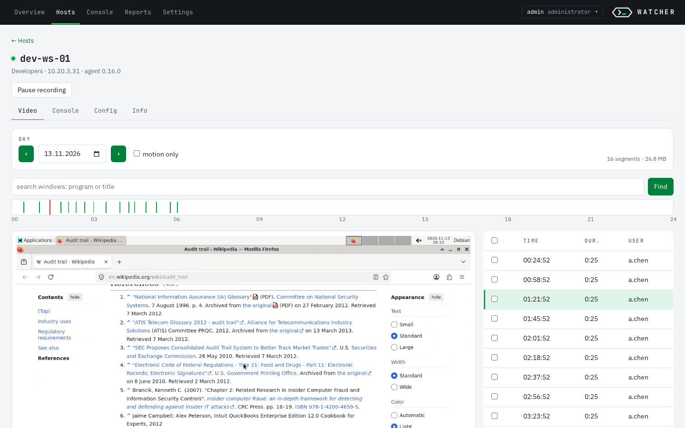
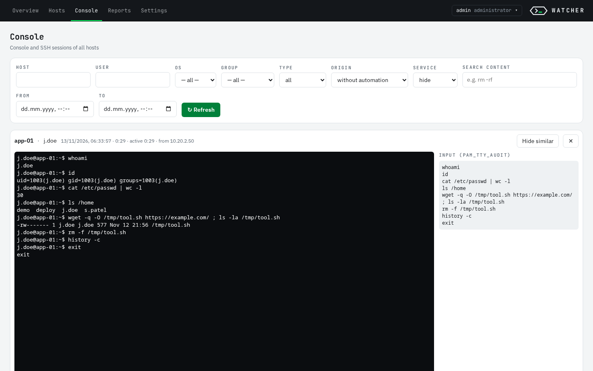
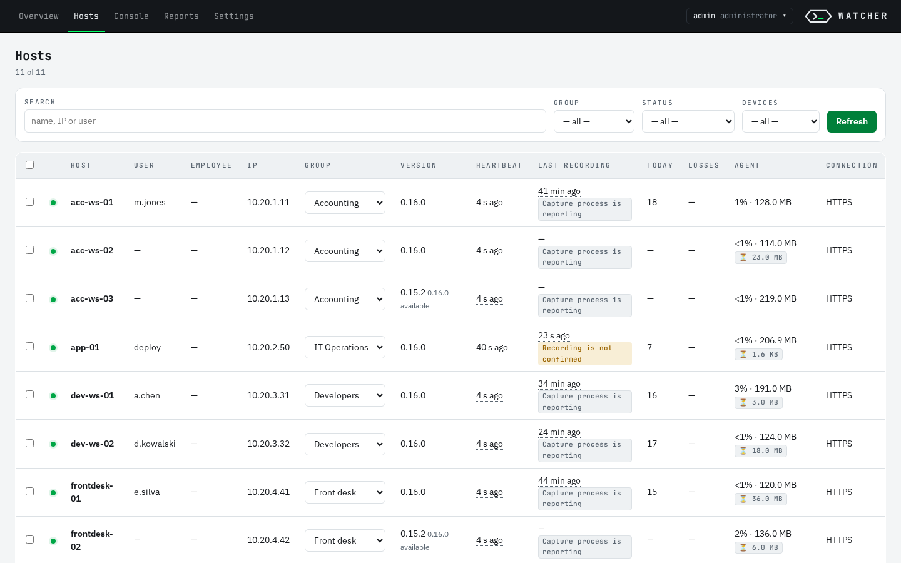
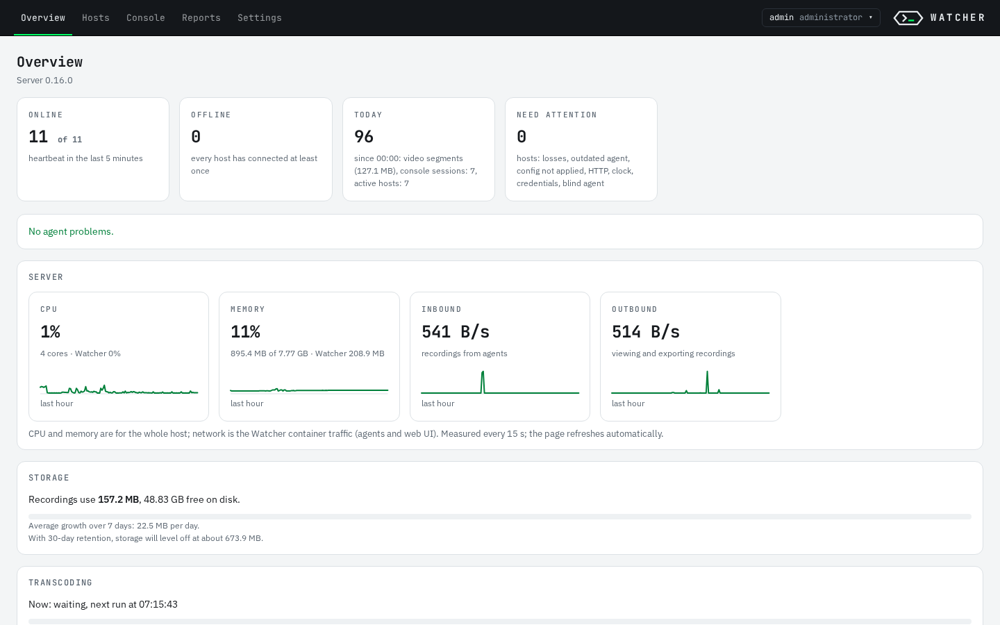
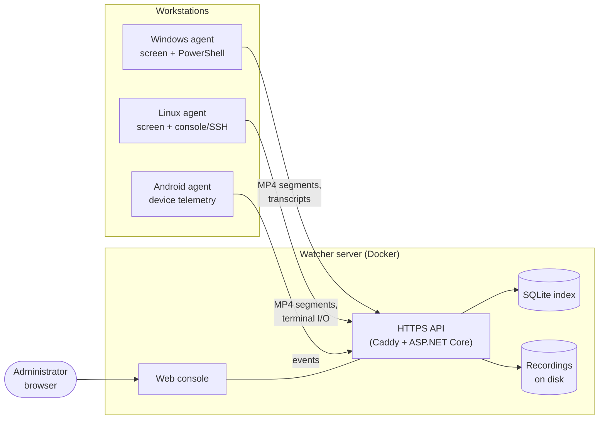

<div align="center">

# Watcher

**Self-hosted workstation and server session auditing.**
Screen recording for Windows and Linux, keystroke-level console and SSH audit,
corporate Android device telemetry — one server, one web console, your hardware.

[](LICENSE)
[](COMMERCIAL.md)
[](https://github.com/dfmjteh-dev/watcher-audit/releases/latest)

English · [Русский](README.ru.md)

</div>

<p align="center"></p>

## Why Watcher

Who logged into that server at 3 a.m., and what did they type? What was on the
operator's screen when the incident happened? Which contractor ran `rm -rf` over
SSH? Watcher answers these questions from a recording, not from guesswork.

- **Runs entirely on your infrastructure.** No cloud, no telemetry, no external
  accounts. A single Linux server with Docker is enough.
- **Records only what changes.** Motion detection keeps idle desktops from
  filling the disk; retention and quotas are enforced on both ends.
- **Hard to switch off quietly.** Protected agents (GuardRepair) can be
  stopped or removed only by a signed command from the server.
- **Built for administrators.** Install in one command, deploy agents with
  MSI/GPO or `.deb`/`.rpm`, manage everything from the browser.

## Features

| | |
|---|---|
| 🖥 **Screen recording** | Windows (every user session, including RDS/terminal servers) and Linux (X11). Motion-triggered MP4 segments with pre-roll, active window and browser domain tracking. |
| ⌨️ **Console & SSH audit** | Linux: input and output of interactive shells, SSH sessions without a TTY (auditd), `scp` and automation. Windows: PowerShell transcripts labelled by origin (SSH, scheduler, desktop, Remoting). |
| 📱 **Android (corporate devices)** | Device-owner agent: app usage, installs and removals, network and security logs, optional consent-based screen recording. |
| 🔎 **Web console** | Per-host timeline with seekable player, search across console sessions on all hosts, fleet registry, reports with drill-down, CSV/MP4 export. |
| 👥 **Access control** | Roles (`admin`, `operator`, `viewer`), viewers scoped to host groups, LDAP/Active Directory login with group-to-role mapping, audit log of every action (CEF/syslog). |
| 🛡 **Agent protection & updates** | Signed agent updates rolled out per group with automatic rollback, tamper-resistant service, diagnostic archives on request. |
| 📦 **Supply chain** | Releases built in CI, `SHA256SUMS` signed keyless with Sigstore cosign, SBOMs for NuGet packages and the server image, Trivy gate. |

## Screenshots

| | |
|---|---|
|  |  |
| **Console** — replay of an SSH session next to the keystrokes captured by `pam_tty_audit` | **Hosts** — every agent with group, version, heartbeat and recording status |
|  | |
| **Overview** — fleet status, today's recordings, server load and storage forecast | |

<sub>Screenshots use a synthetic demo fleet on a clean install; host names, users and addresses are made up.</sub>

## How it works



Agents buffer recordings in a local queue and upload them when the server is
reachable, so a network outage does not lose data. Details:
[docs/architecture.md](docs/architecture.md).

## Quick start

On a Linux host with Docker, download `watcher-server-X.Y.Z.tar.gz` from the
[latest release](https://github.com/dfmjteh-dev/watcher-audit/releases/latest)
(the archive contains images and ready-built agents; no SDK or internet access
is needed on the server):

```bash
tar -xzf watcher-server-X.Y.Z.tar.gz && cd watcher-server-X.Y.Z
sudo ./install-server.sh --domain watcher.example.internal
```

The installer starts the server with HTTPS, generates the CA, update-signing
and code-signing keys, and builds an **agent kit** preconfigured for this
server. It prints the web console address and the initial `admin` password.

No Docker yet? The installer explains the options and offers to install Docker
Engine from Docker's official repository (`--install-docker` does it without
asking). Running without Docker is also supported: `--systemd`.

Then install agents from **Settings → Agent installation** in the web console:

- **Windows** — `watcher-agent.msi`: double-click, `msiexec /qn` or GPO, no parameters.
- **Linux** — `watcher-agent-linux-<version>.tar.gz`: unpack and run `install.sh` (installs `.deb`/`.rpm`).
- **Android** — provisioning kit for device-owner enrollment.

Verify a release before installing:

```bash
cosign verify-blob SHA256SUMS --bundle SHA256SUMS.sigstore.json \
  --certificate-oidc-issuer https://token.actions.githubusercontent.com \
  --certificate-identity-regexp '^https://github.com/dfmjteh-dev/watcher-audit/\.github/workflows/release\.yml@refs/tags/v'
sha256sum -c SHA256SUMS --ignore-missing
```

## Documentation

> Detailed documentation is currently in Russian. The web console is
> available in English and Russian.

| | |
|---|---|
| [Installation](docs/install.md) | Server (Docker or systemd), agents, keys |
| [Configuration](docs/configuration.md) | Every server and agent setting |
| [Operations](docs/operations.md) | Updates, backup, monitoring, troubleshooting |
| [Architecture](docs/architecture.md) | Components and design decisions |
| [Data collected](docs/data-collected.md) | What is recorded — for security, legal and HR teams |
| [Agent protection](docs/agent-protection.md) | Tamper resistance and its limits |
| [Antivirus / EDR exclusions](docs/av-edr.md) | Paths and processes to whitelist |
| [Code signing](docs/codesign.md) | Authenticode for the Windows agent |
| [Development](docs/development.md) | Building, testing, release process |
| [Changelog](CHANGELOG.md) | What changed and how to upgrade |

## Legal notice

Watcher records user activity. In most jurisdictions employees must be
informed, and monitoring must have a lawful basis and a defined purpose
(for example GDPR in the EU, Federal Law 152-FZ and the Labour Code in Russia).
Deploying Watcher, notifying users and choosing what to record is the
responsibility of the organisation that operates it.
[docs/data-collected.md](docs/data-collected.md) lists exactly what is
collected so you can prepare that notice.

## License

Watcher is **dual-licensed**:

- **[GNU AGPL-3.0](LICENSE)** — free to use, modify and self-host. If you
  distribute a modified version or offer it to others over a network, you must
  publish your source code under the same license.
- **[Commercial license](COMMERCIAL.md)** — for organisations that want to
  embed Watcher in a proprietary product, offer it as a service without
  publishing changes, or need a support agreement.

Third-party components and their licenses: [THIRD_PARTY_NOTICES.md](THIRD_PARTY_NOTICES.md).

## Contributing

Bug reports and pull requests are welcome — see [CONTRIBUTING.md](CONTRIBUTING.md).
Contributions require agreeing to the [Contributor License Agreement](CLA.md),
which keeps dual licensing possible. Security issues: [SECURITY.md](SECURITY.md).
