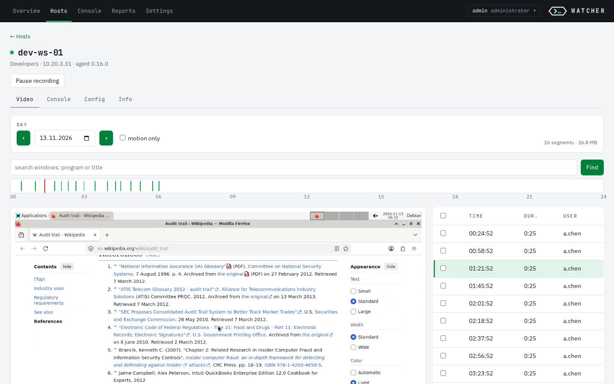
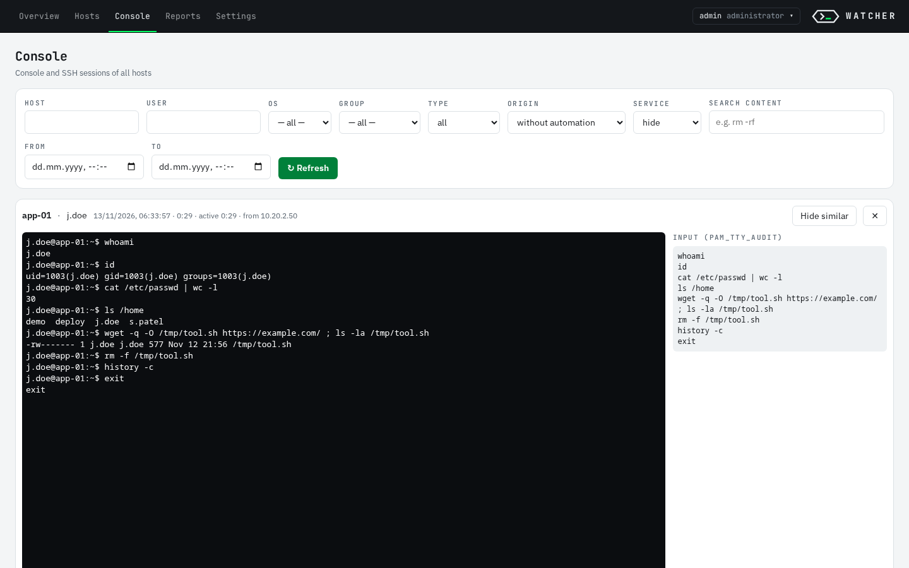
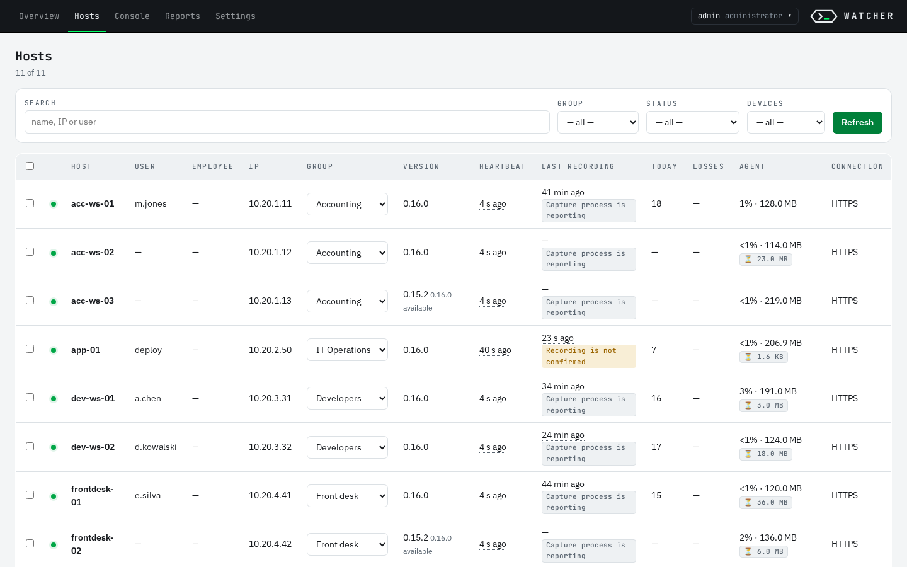
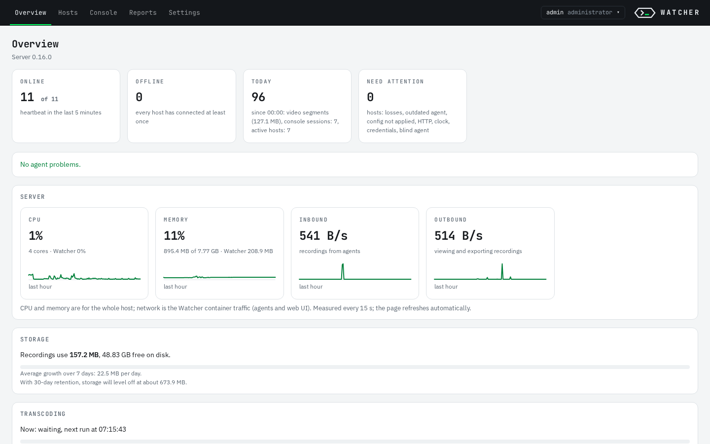
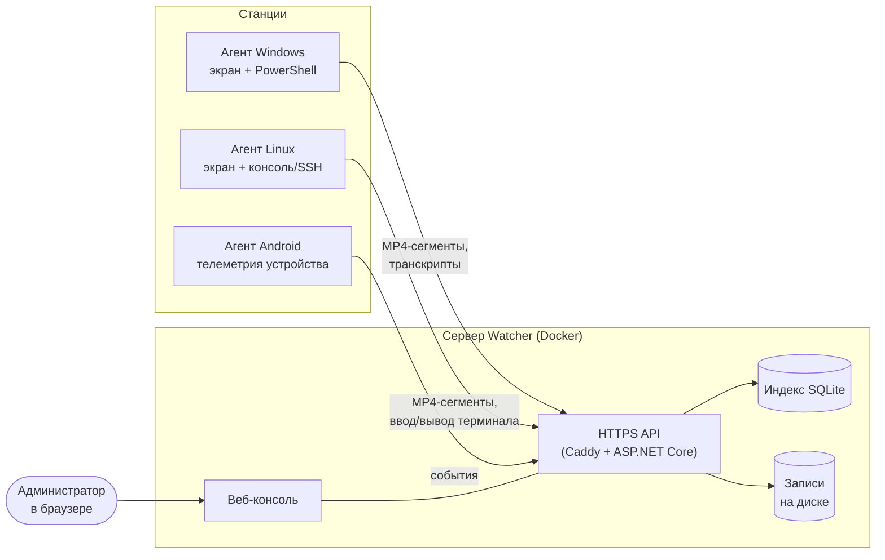

<div align="center">

# Watcher

**Аудит рабочих станций и серверов на своей инфраструктуре.**
Запись экрана Windows и Linux, аудит ввода и вывода в консоли и SSH,
телеметрия корпоративных Android-устройств — один сервер, одна веб-консоль,
ваше железо.

[](LICENSE)
[](COMMERCIAL.md)
[](https://github.com/dfmjteh-dev/watcher-audit/releases/latest)

[English](README.md) · Русский

<sub>Статус: в активной разработке. 1.0.0 — первый публичный релиз; с октября 2026 года система работает в продакшене одной организации.</sub>

</div>

<p align="center"></p>

## Зачем

Кто зашёл на сервер в три ночи и что набирал? Что было на экране оператора в
момент инцидента? Кто из подрядчиков выполнил `rm -rf` по SSH? Watcher отвечает
на эти вопросы по записи, а не по догадкам.

- **Работает целиком у вас.** Без облака, телеметрии и внешних учёток.
  Достаточно одного Linux-сервера с Docker.
- **Пишет только изменения.** Детектор движения не даёт простаивающим
  рабочим столам забить диск; срок хранения и квоты соблюдаются на обеих сторонах.
- **Тихо не отключить.** Защищённого агента (GuardRepair) можно остановить
  или удалить только подписанной командой с сервера.
- **Сделан для администраторов.** Сервер ставится одной командой, агенты —
  MSI/GPO или `.deb`/`.rpm`, всё управление — из браузера.

## Возможности

| | |
|---|---|
| 🖥 **Запись экрана** | Windows (все сессии пользователей, включая RDS/терминальные серверы) и Linux (X11). MP4-сегменты по движению с предзаписью, активное окно и домен вкладки браузера. |
| ⌨️ **Аудит консоли и SSH** | Linux: ввод и вывод интерактивных shell, SSH-команды без терминала (auditd), `scp` и автоматизация. Windows: транскрипты PowerShell с меткой происхождения (SSH, планировщик, рабочий стол, Remoting). |
| 📱 **Android (корпоративные устройства)** | Агент — владелец устройства: использование приложений, установки и удаления, сетевой журнал и журнал безопасности, запись экрана по согласию. |
| 🔎 **Веб-консоль** | Лента записей хоста с плеером и перемоткой, поиск по консольным сессиям всех хостов, реестр хостов, отчёты с расшифровкой, экспорт CSV/MP4. |
| 👥 **Права доступа** | Роли `admin`, `operator`, `viewer`; viewer видит только свои группы хостов; вход через LDAP/Active Directory с сопоставлением групп и ролей; журнал аудита всех действий (CEF/syslog). |
| 🛡 **Защита и обновление агентов** | Подписанные обновления по группам с автоматическим откатом, защита службы от остановки, диагностические архивы по запросу. |
| 📦 **Цепочка поставки** | Релизы собираются в CI, `SHA256SUMS` подписан cosign (Sigstore) без ключа, SBOM для NuGet и образа сервера, проверка Trivy. |

## Скриншоты

| | |
|---|---|
|  |  |
| **Консоль** — воспроизведение SSH-сессии рядом с вводом, записанным `pam_tty_audit` | **Хосты** — каждый агент: группа, версия, связь и состояние записи |
|  | |
| **Обзор** — состояние парка, записи за сегодня, нагрузка сервера и прогноз хранилища | |

<sub>Скриншоты сняты на чистой установке с синтетическим демо-парком; имена хостов, пользователей и адреса вымышлены. Интерфейс на скриншотах — английский, переключается на русский в меню пользователя.</sub>

## Как устроено



Агенты складывают записи в локальную очередь и выгружают, когда сервер
доступен, — обрыв сети не теряет данные. Подробно:
[docs/architecture.md](docs/architecture.md).

## Быстрый старт

На Linux-хосте с Docker скачайте `watcher-server-X.Y.Z.tar.gz` из
[последнего релиза](https://github.com/dfmjteh-dev/watcher-audit/releases/latest)
(в архиве образы и готовые агенты; SDK и интернет на сервере не нужны):

```bash
tar -xzf watcher-server-X.Y.Z.tar.gz && cd watcher-server-X.Y.Z
sudo ./install-server.sh --domain watcher.example.internal
```

Установщик поднимает сервер с HTTPS, выпускает CA, ключ подписи обновлений и
сертификат подписи кода и собирает **комплект агентов**, уже настроенный на
этот сервер. В конце печатаются адрес веб-консоли и пароль `admin`.

Docker ещё нет? Установщик объяснит варианты и предложит поставить Docker Engine
из официального репозитория Docker (`--install-docker` — без вопроса). Можно
и без Docker: `--systemd`.

Агенты — в веб-консоли, **Настройки → Установка агентов**:

- **Windows** — `watcher-agent.msi`: двойной щелчок, `msiexec /qn` или GPO, без параметров.
- **Linux** — `watcher-agent-linux-<версия>.tar.gz`: распаковать и запустить `install.sh` (ставит `.deb`/`.rpm`).
- **Android** — комплект для регистрации владельцем устройства.

Проверка подлинности релиза:

```bash
cosign verify-blob SHA256SUMS --bundle SHA256SUMS.sigstore.json \
  --certificate-oidc-issuer https://token.actions.githubusercontent.com \
  --certificate-identity-regexp '^https://github.com/dfmjteh-dev/watcher-audit/\.github/workflows/release\.yml@refs/tags/v'
sha256sum -c SHA256SUMS --ignore-missing
```

## Документация

| | |
|---|---|
| [Установка](docs/install.md) | Сервер (Docker или systemd), агенты, ключи |
| [Конфигурация](docs/configuration.md) | Все параметры сервера и агентов |
| [Эксплуатация](docs/operations.md) | Обновления, бэкап, мониторинг, диагностика |
| [Архитектура](docs/architecture.md) | Компоненты и проектные решения |
| [Какие данные собираются](docs/data-collected.md) | Для ИБ, юристов и кадровой службы |
| [Защита агента](docs/agent-protection.md) | Устойчивость к отключению и её границы |
| [Исключения для антивирусов и EDR](docs/av-edr.md) | Пути и процессы |
| [Подпись кода](docs/codesign.md) | Authenticode для агента Windows |
| [Участие в разработке](CONTRIBUTING.md) | Сборка из исходников, тесты, pull request'ы |
| [Журнал изменений](CHANGELOG.md) | Что изменилось и как обновляться |

## Правовые аспекты

Watcher записывает действия пользователей. В большинстве юрисдикций сотрудников
нужно уведомить, а у контроля должны быть законное основание и цель (в России —
152-ФЗ и Трудовой кодекс, в ЕС — GDPR). Решение о развёртывании, уведомление
сотрудников и выбор того, что записывать, — ответственность организации,
которая эксплуатирует систему. Полный перечень собираемых данных для такого
уведомления — [docs/data-collected.md](docs/data-collected.md).

## Лицензия

У Watcher **двойное лицензирование**:

- **[GNU AGPL-3.0](LICENSE)** — бесплатно использовать, изменять и разворачивать
  у себя. Кто распространяет изменённую версию или предоставляет её другим по
  сети, обязан опубликовать свой исходный код под той же лицензией.
- **[Коммерческая лицензия](COMMERCIAL.md)** — для организаций, которые хотят
  встроить Watcher в закрытый продукт, предоставлять его как сервис без
  публикации изменений или получить договор поддержки.

Сторонние компоненты и их лицензии — [THIRD_PARTY_NOTICES.md](THIRD_PARTY_NOTICES.md).

## Участие

Сообщения об ошибках и pull request'ы приветствуются — [CONTRIBUTING.md](CONTRIBUTING.md).
Для вклада в код нужно согласие с [CLA](CLA.md) — без него двойное
лицензирование невозможно. Уязвимости — [SECURITY.md](SECURITY.md).
